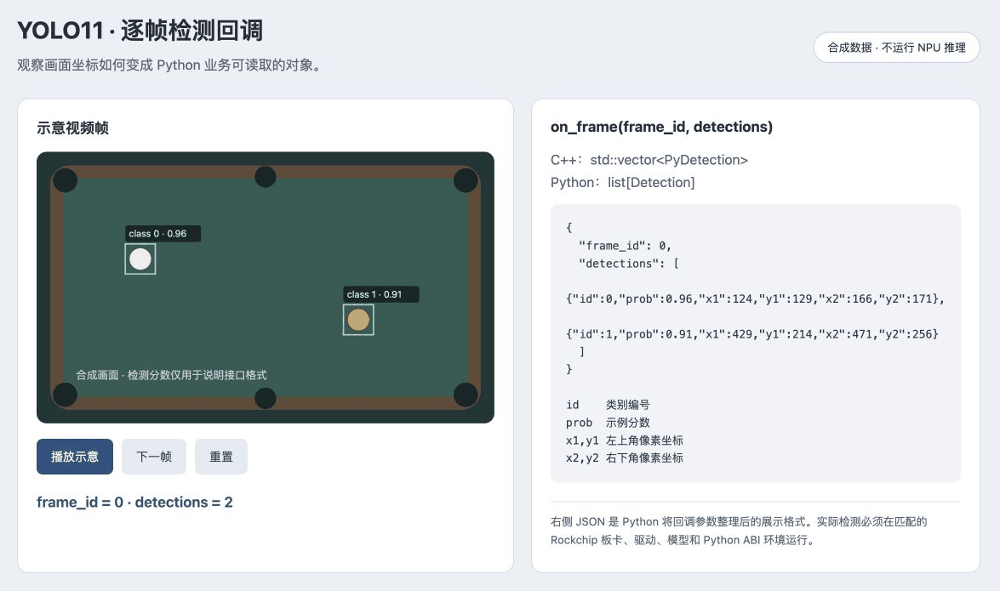
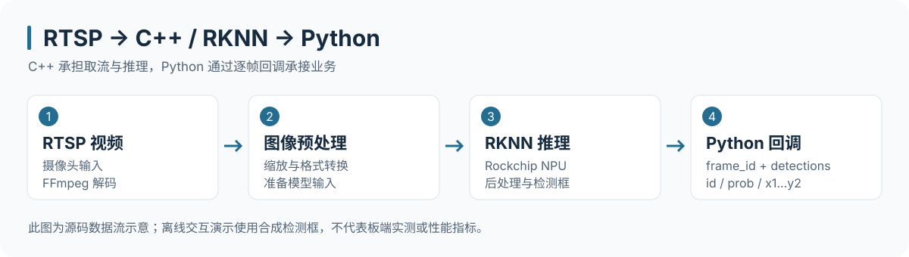

# RKNN YOLO11 · C++ / Python 实时检测

面向 Rockchip 板端的 YOLO11 推理工程：使用 C++ 接入 RTSP、调用 RKNN，并通过 pybind11 将逐帧检测结果交给 Python 业务代码。

## 效果与接口预览



上图为**合成画面与检测框的接口示意**：左侧画面变化，对应右侧 `frame_id` 和 `Detection` 字段变化。它不执行 NPU 推理，也不代表板端准确率或 FPS。

## 工作流程



## 项目演示

**离线交互**：克隆仓库后，用浏览器打开 [callback-demo.html](docs/showcase/callback-demo.html)，点击“播放示意”或“下一帧”观察坐标与回调参数。也可在仓库根目录运行 `python3 -m http.server 8080 --bind 127.0.0.1`，访问 `http://127.0.0.1:8080/docs/showcase/callback-demo.html`。

**真实板端**：在匹配的 Rockchip 板卡、RKNN Runtime、模型与 Python ABI 环境中编译 `yolo_rtsp`，通过 `start_stream(rtsp_url, model_path, callback)` 接入 RTSP。[查看真实调用样例与环境要求](docs/showcase/README.md)。

本次文档更新未在 Rockchip 板端运行推理。下文接口说明对应 [当前 C++ 绑定源码](bin/yolo11/cpp/rtsp_python_binding.cc)。

---

## 1. 编译指南

如需重新生成适用于特定板端的动态链接库（`.so` 文件），例如部署由于 RK356x / RK3576 的架构：

请在模型库根目录执行以下编译命令：
```bash
./build-linux.sh -t rk356x -a aarch64 -d yolo11
```
*注意：本命令会构建针对 aarch64 架构 Linux 系统优化的算法库，并通过 CMake 将 `rtsp_python_binding.cc` 编译为可以通过 Python 调用的 `.so` 文件。*

## 2. 接口原理解析 (`rtsp_python_binding.cc`)

### 2.1 Python 通信数据结构 (`PyDetection`)

在 C++ 层面推理完毕后，需要将检测框（Bounding Boxes）传回 Python。为避免底层指针与数据释放出现内存错误，C++ 层定义了一个简洁且内存连续的结构：
```cpp
struct PyDetection {
    int id;             // 分类ID，如白球、彩球等
    float prob;         // 检测置信度
    int x1, y1, x2, y2; // 坐标点框
};
```
当传回 Python 时，可以通过 `det.id`, `det.prob`, `det.x1` 等进行类属性式调用。

### 2.2 跨语言回调函数 (`DetectCallback`)
```cpp
using DetectCallback = std::function<void(long frame_id, std::vector<PyDetection>)>;
```
这是至关重要的一环，通过 `std::function` 将 Python 里定义的一个 `on_frame_detected` 函数打包成了 C++ 可识别的格式。该结构支持将连续的多目标列表直接从 C++ 的 `vector<PyDetection>` 无缝转换到 Python `List`。

### 2.3 核心流核心控制器 (`start_stream_wrapper`)
```cpp
void start_stream_wrapper(std::string rtsp_url, std::string model_path, DetectCallback callback) {                                                                  
    YoloStreamProcessor processor;
    processor.start_stream(rtsp_url, model_path, callback);
}
```
主要职能：
- 接收 `rtsp_url` 建立 FFmpeg 硬解码或者并发取流线程。
- 加载传入的 `*.rknn` 路径将模型拉入 NPU 初始化。
- 在推流的同时抛出 `callback` 到 Python 端，实现 **C++ 跑纯算力计算(图像转码模型推理)，Python 写纯业务逻辑**。

### 2.4 Pybind11 模块注册 (`PYBIND11_MODULE`)
```cpp
PYBIND11_MODULE(yolo_rtsp, m) {
    m.def("start_stream", &start_stream_wrapper,
          py::arg("rtsp_url"),
          py::arg("model_path"),
          py::arg("callback"),
          "Start RTSP stream and call Python callback on each frame");
          
    py::class_<PyDetection>(m, "Detection")
        .def_readonly("id", &PyDetection::id)
        .def_readonly("prob", &PyDetection::prob)
        .def_readonly("x1", &PyDetection::x1)
        .def_readonly("y1", &PyDetection::y1)
        .def_readonly("x2", &PyDetection::x2)
        .def_readonly("y2", &PyDetection::y2);
}
```
通过以上宏包裹最终生成了名为 `yolo_rtsp` 的模块。也就是为何在主程序 Python 中需要 `import yolo_rtsp`，然后在接收对象中可以读到各种边界坐标并输出 Kalman 结果。

## 许可证与商业使用 / License and commercial use

**本仓库中维护者有权许可的原创内容采用 [PolyForm Noncommercial 1.0.0](LICENSE)，仅许可非商业用途；商业使用须另行取得书面授权。**
第三方内容、必须保留上游许可的部分及旧版本已授予的权利不受此变更覆盖。详见 [版权与第三方声明](COPYRIGHT.md)。

Original material the maintainer is entitled to license is available for noncommercial purposes under [PolyForm Noncommercial 1.0.0](LICENSE). Commercial use requires separate written permission. Third-party and previously granted rights are preserved; see [COPYRIGHT.md](COPYRIGHT.md).
